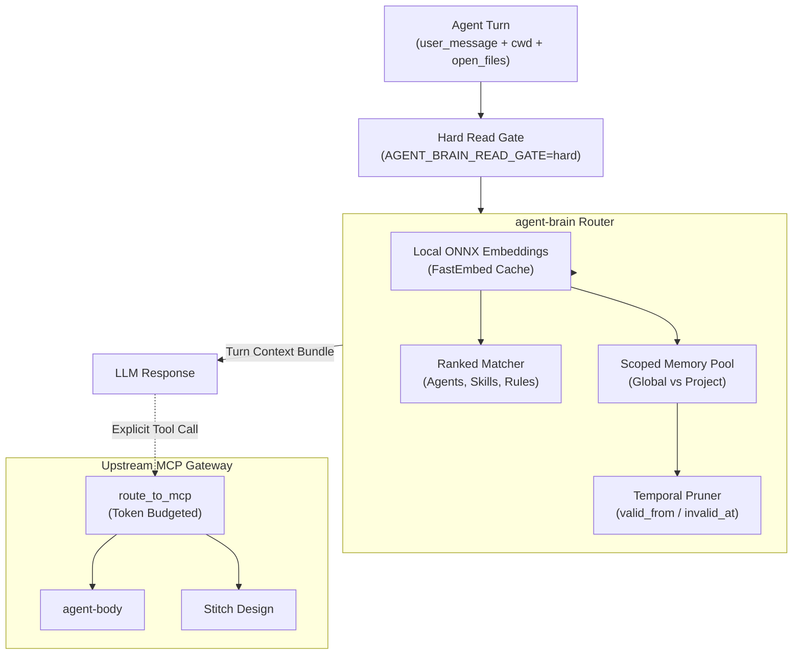

In [Part 1 of this series](/blog/agent-brain-local-mcp-routing/), I introduced [agent-brain](https://github.com/abhiudayg/agent-brain): a local Rust MCP server designed to solve ungoverned context retrieval by answering one question per agent turn: **what should the model see right now?**

Over months of daily use across projects, our routing requirements matured. Storing flat memory facts in a single bucket created noise. Facts that were true yesterday became obsolete after an architectural refactor. And developers rarely work inside a single tool — context lives scattered across Cursor, OpenCode, Codex, Gemini, and Antigravity.

This is **Part 2**, focusing on how agent-brain handles **scoped memory**, **temporal pruning**, **cross-session ingestion**, and **upstream MCP routing**.

## The Evolution of the Routing Loop

Here is the expanded routing architecture in agent-brain today:



## 1. Scoped Memory Taxonomy (`global` vs `project`)

Not all learned facts belong everywhere. If an agent discovers that a project uses `bun test` instead of `npm test`, injecting that fact into a Python data pipeline repository wastes tokens and confuses the model.

agent-brain partitions memory into two primary scopes:

```rust
#[derive(Debug, Clone, Serialize, Deserialize)]
pub enum MemoryScope {
    Global,
    Project { root_hash: String },
}

pub struct MemoryFact {
    pub id: Uuid,
    pub topic: String,
    pub fact: String,
    pub scope: MemoryScope,
    pub confidence: f32,
    pub polarity: Option<FactPolarity>,
    pub valid_from: Option<i64>,
    pub invalid_at: Option<i64>,
}
```

- **`global`**: Architectural principles, personal coding style (immutability, error handling standards, preferred CLI tools). These surface across all workspaces.
- **`project`**: Project-specific invariants (build scripts, test recipes, package versions, migration decisions). Keyed to the canonical repository root hash.
- **`polarity`**: Distinguishes verified recipes from anti-patterns (`positive`, `negative`, `anti-pattern`). If an agent previously tried a command flag that caused a build failure, the router flags it as an anti-pattern to prevent repeating the mistake.

## 2. Temporal Pruning: Expiration & Confidence Scoring

Static memory stores turn into digital landfills. Architectural decisions change, dependencies upgrade, and temporary workarounds become debt.

agent-brain implements millisecond-level temporal validity:

```json
{
  "topic": "astro-upgrade-temporary-flag",
  "fact": "Use --legacy-peer-deps until sharp 0.35 is released",
  "confidence": 0.85,
  "valid_from": 1781700000000,
  "invalid_at": 1782500000000
}
```

During each routing turn, the temporal evaluator prunes facts whose `invalid_at` timestamp has passed into an archive partition. High-confidence facts that are repeatedly reinforced by successful verification runs gain score boosts, while unverified assertions decay over time.

## 3. Cross-Session Ingestion: Unifying Agent Silos

Modern engineering rarely happens in a single assistant. You might brainstorm architecture in Gemini, execute implementation in Cursor or Antigravity, and review pull requests in Codex.

agent-brain periodically ingests session transcripts from each client's local storage:

| Environment | Ingest Path | Extracted Signal |
|-------------|-------------|------------------|
| Cursor | `~/.cursor/.../transcript.jsonl` | File edits, executed commands, turn intents |
| Gemini / Antigravity | `~/.gemini/antigravity-cli/brain/...` | Plans, subagent trajectories, research digests |
| OpenCode / Codex | Session JSON dumps | Task completions, error traces |

Session digests are condensed under a strict token budget. When you switch between tools, `route_task` immediately surfaces:

> *"Retrieved via route_task. Session digest (Gemini, 2 turns ago): Redesigned blog with Stitch tokens and upgraded Node LTS to v24.22.1."*

No manual copy-pasting of context across IDEs.

## 4. Upstream MCP Routing with `route_to_mcp`

As MCP servers proliferate (filesystem, GitHub, databases, UI design tools), connecting 20 distinct servers directly to an LLM blows through context limits before you write a single line of code.

agent-brain acts as an **MCP Gateway**:

- Upstream servers (such as `agent-body` for sandboxed bash execution, or Google `stitch` for generative UI design) register behind agent-brain.
- Router suggestions tell the model which upstream tool is appropriate (`suggested_tools`).
- The model calls `route_to_mcp` explicitly with a target server, tool name, arguments, and a `max_tokens` cap.
- The response is semantically truncated, protecting the agent from massive JSON payloads.

```json
// Example: Invoking Stitch through agent-brain
{
  "server": "stitch",
  "tool": "generate_screen_from_text",
  "arguments": {
    "projectId": "14654054411761884985",
    "prompt": "Modern engineering blog editorial hero"
  },
  "max_tokens": 500
}
```

## 5. Autonomic Hard Read Gates

To guarantee that agents do not bypass the routing system, we run with `AGENT_BRAIN_READ_GATE="hard"`.

When this gate is active:
1. Native file reading or grepping triggers a routing warning if `route_task` was not called at the start of the turn.
2. Every durable outcome must conclude with `store_memory` recording the decision and verification outcome.

This turns agent context management from an unpredictable prompt-engineering trick into a disciplined, measurable runtime loop.

## What is Next

In Part 3, we will explore:
- Vector indexing benchmarks comparing FastEmbed ONNX models on Apple Silicon
- Multi-brain synchronisation via NATS and JetStream (`agent-nerves`)
- Memory-to-skill promotion pipelines (`promote_to_skill`)

**Repo:** [github.com/abhiudayg/agent-brain](https://github.com/abhiudayg/agent-brain)
