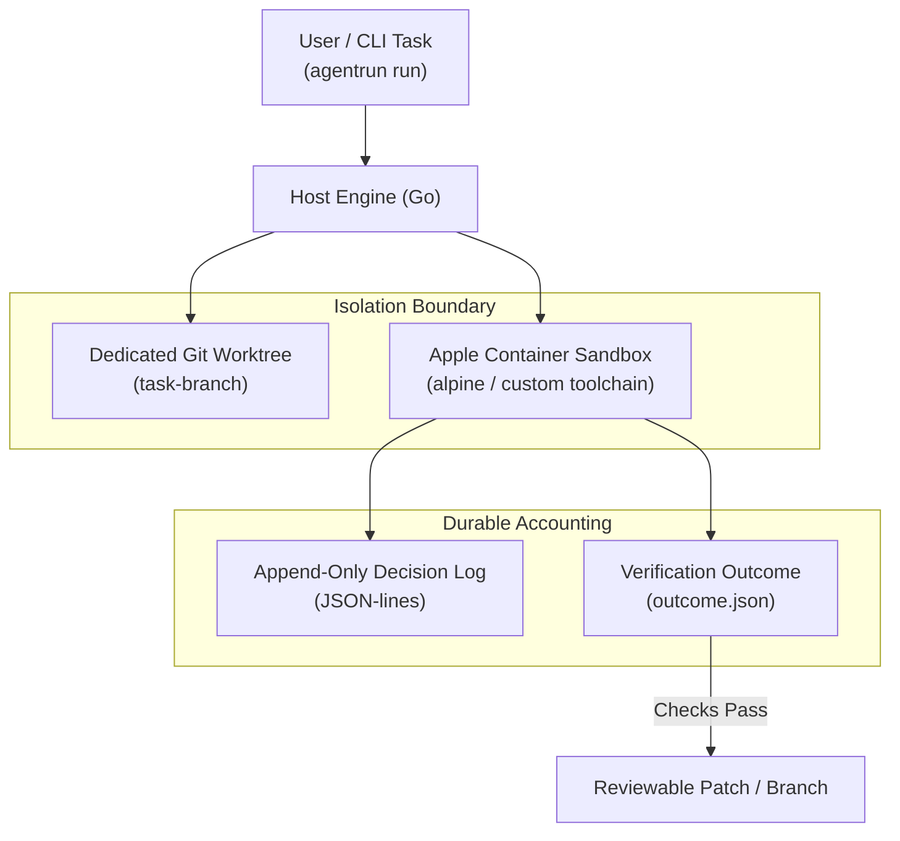

Autonomous coding agents are powerful, but giving an LLM unconstrained access to your terminal is playing Russian roulette with your local environment. One hallucinated `rm -rf`, unexpected port binding, or polluted global state can ruin hours of work.

[AgentRun](https://github.com/abhiudayg/agentrun) is a system for running coding-agent tasks as **isolated, reproducible, and recoverable jobs on your own machine**. It packages everything into a single binary with two target modes:

- **Lite (current focus):** One developer, one machine. Each agent run operates in its own container and isolated git worktree. You can monitor status, stream logs, cancel safely, and inspect a reviewable git branch or patch.
- **Full (planned):** A shared team host with a shared queue, per-user identity, quotas, an audit trail, and organization security policy.

Here is an inside look at the architecture, current implementation milestones, and design principles shaping AgentRun.

## Why Current Agent Sandboxing Falls Short

Most developer agent setups suffer from three fundamental flaws:

1. **Unbounded Mutation:** Agents run bash scripts directly in your active development directory. If the model makes a mistake, your uncommitted changes and git staging index get scrambled.
2. **Open-Ended Loops:** Without a verifiable contract, agents can loop infinitely, re-running tests or installing conflicting dependencies until token budgets or quotas are exhausted.
3. **No Forensic Traceability:** When an agent claims it fixed a bug, there is rarely an immutable log showing what decisions were made, why an approach was chosen, and whether verification actually passed.

## Architecture & Lifecycle

AgentRun enforces strict boundaries around each execution attempt:



## 1. Native Sandboxing with Apple's `container` CLI

On Apple Silicon (macOS), virtualization should not require heavy external hypervisors or third-party virtualization daemons.

AgentRun's capability test suite drives Apple's native `container` CLI (`test/capability`). Every execution runs inside an isolated root filesystem:

- **Ephemeral Networks:** Tasks bind to dedicated subnets (`spike-net-*`) preventing unauthorized lateral access to local host services.
- **Controlled Mounts:** Only the task's dedicated git worktree is mounted into the container. The parent repository, SSH keys, AWS credentials, and host files remain completely inaccessible.
- **Clean Teardown:** Signal handlers ensure that even if an agent crashes or times out, container resources and temporary mounts are cleanly destroyed.

## 2. Bounded Verification Loops (`internal/verify`)

One of our core invariants is that an agent cannot simply declare success — it must **prove** it through deterministic checks.

We built `internal/verify` with a bounded repair loop:

```go
type Check struct {
    Name    string   `json:"name"`
    Command []string `json:"command"`
    Timeout time.Duration `json:"timeout"`
}

type Outcome struct {
    Passed      bool          `json:"passed"`
    Attempts    int           `json:"attempts"`
    CheckResults []CheckResult `json:"check_results"`
    DurationMs  int64         `json:"duration_ms"`
}
```

- **Fail-Fast Checks:** Tests and linters run in sequence. If step 1 (`gofmt`) fails, the runner skips subsequent long-running integration tests and delivers the exact diff failure back to the agent.
- **Bounded Repair:** If checks fail, the agent is given a finite number of attempts (e.g., max 3 attempts) to repair the code. If no forward progress is detected between attempts, AgentRun halts execution immediately to preserve token budgets.
- **Durable Outcome:** Successful or failed runs emit an `outcome.json` evidence file recording the exact exit codes, stdout samples, and timestamps.

## 3. Append-Only Decision Logging (`internal/decisionlog`)

Coding agents reason through intermediate decisions before invoking tools. To make autonomous workflows auditable, `internal/decisionlog` implements an append-only JSON-lines contract:

```go
// Entry represents an immutable agent rationale step
type Entry struct {
    Timestamp time.Time `json:"timestamp"`
    Decision  string    `json:"decision"`
    Rationale string    `json:"rationale"`
    Tool      string    `json:"tool,omitempty"`
}
```

Files are opened with `os.O_APPEND|os.O_CREATE|os.O_WRONLY` and strict permissions (`0600`). Empty decisions or whitespace-only records are rejected with `ErrEmptyDecision`.

This guarantees a readable, sequential playback of why the agent took each action during the run.

## 4. The 4-Line Standard Error Contract (`internal/errors`)

In CLI tooling, unstructured error dumps make automated debugging frustrating. AgentRun standardizes all command errors on a crisp 4-line format:

```
agentrun: error: unknown flag --bad-flag
  code: ERR_UNKNOWN_FLAG
  context: parsing command line arguments for 'run'
  remedy: check 'agentrun --help' for available flags
```

Internal tools like `cmd/agentrun-dev evidence <dir>` parse this format deterministically, ensuring that humans and automation agents receive the exact same error clarity.

## Current Status & Next Steps

AgentRun is actively under development in `developer/personal/agentrun`:

- [x] Shared foundations for modes, policy digest, and provenance records (`internal/mode`, `internal/policy`, `internal/record`)
- [x] Standard error catalog and formatting (`internal/errors`)
- [x] Append-only decision logging with ordered readback tests (`internal/decisionlog`)
- [x] Bounded verify loops with evidence outcome persistence (`internal/verify`)
- [x] Apple container isolation capability test suite (`test/capability`)
- [ ] Phase 1 runner daemon and CLI command dispatch

**Repo:** [github.com/abhiudayg/agentrun](https://github.com/abhiudayg/agentrun)
