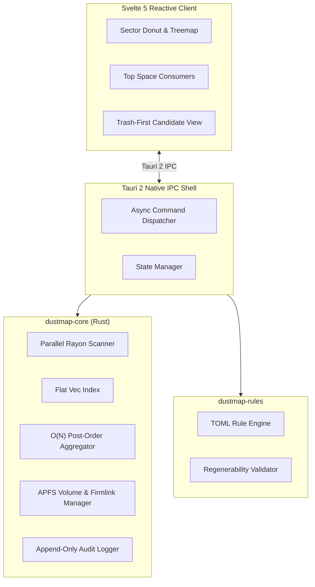

Every Mac user eventually hits the same wall: macOS displays 80GB consumed by mysterious "System Data", the storage settings offer no actionable breakdown, and existing graphical cleaners either want a monthly subscription or feel uncomfortably opaque about what they delete.

[DustMap](https://github.com/abhiudayg/dustmap) is an open-source, offline-first macOS disk space analyzer and conservative cleaner built with **Rust**, **Tauri 2**, and **Svelte 5**. It scans multi-million entry filesystems in seconds, renders interactive squarified treemaps and sector donuts, and provides an explainable, Trash-first cleaner with an append-only audit trail.

Here is the technical journey behind building it — from multi-threaded filesystem traversal to memory layout optimization and APFS dual-metric reconciliation.

## The Problem: Why Disk Analysis on APFS is Hard

Traversing modern macOS storage is deceptively complex:

1. **APFS Firmlinks & Mount Points:** macOS separates the read-only system volume from the writable data volume (`/System/Volumes/Data`), tying them together with APFS "firmlinks". A naive recursive tree walk will either double-count files or fall into infinite traversal loops.
2. **Logical vs Allocated Bytes:** Sparse files, inline compression, clone-on-write snapshots, and block-level allocation mean that `file_size` reported by standard file attributes rarely matches actual disk consumption.
3. **Deep Hierarchies & Memory Bloat:** Indexing 3,000,000 files in traditional pointer-heavy tree structures (`struct Node { children: Vec<Box<Node>> }`) fragments heap memory and slows down the Garbage Collector or allocator.

## Architecture at a Glance

DustMap is organized as a modular Cargo workspace decoupled from the UI layer:



## 1. Parallel Work-Stealing Traversal

Filesystem traversal is I/O-heavy, but on modern NVMe drives and Apple Silicon unified storage, single-threaded traversal leaves massive bandwidth on the table.

We built `scanner.rs` using a bounded `rayon` work-stealing pool combined with `walkdir`. Key design decisions:

- **Firmlink Pruning:** Before recursing into directories, we query the APFS mount table and filter known system firmlink synthetic junctions (`/System/Volumes/Data/Users` vs `/Users`).
- **Atomic Cancellation & Throttling:** Users can pause or abort a scan at any millisecond via `Arc<AtomicBool>`.
- **Progress Channels:** A bounded lock-free channel emits periodic snapshots (`elapsed_ms`, `accounted_bytes`, `seen_entries`) to keep the Svelte UI responsive at 60 FPS without saturating the IPC boundary.

```rust
// scanner.rs snippet: work-stealing traversal with firmlink check
pub fn scan_volume_parallel(
    root: &Path,
    cancel_token: Arc<AtomicBool>,
    progress_tx: Sender<ScanProgress>,
) -> Result<FlatTreeIndex> {
    let mut builder = FlatIndexBuilder::new();
    
    rayon::scope(|s| {
        traverse_directory(root, &builder, &cancel_token, &progress_tx, s);
    });

    builder.build_and_aggregate()
}
```

## 2. Flat Tree Index: Eliminating Pointer Chasing

In early prototypes, a conventional node-and-pointer tree consumed over **450MB of RAM** when scanning a developer's 2TB drive.

We replaced nested tree nodes with a contiguous, flat `Vec<Entry>` indexed by a lightweight 32-bit newtype:

```rust
#[derive(Copy, Clone, Debug, PartialEq, Eq, Hash)]
pub struct EntryId(pub u32);

pub struct Entry {
    pub id: EntryId,
    pub parent_id: Option<EntryId>,
    pub name: CompactString,
    pub logical_size: u64,
    pub allocated_size: u64,
    pub flags: EntryFlags,
    pub first_child: Option<EntryId>,
    pub next_sibling: Option<EntryId>,
}
```

### Why this matters:
- **Zero Heap Fragmentation:** All entries reside in one pre-allocated buffer.
- **Cache Locality:** Iterating through parent-child relations involves sequential array lookups rather than chasing scattered heap pointers.
- **Post-Order Aggregation:** After traversal, directory totals are computed in a single $O(N)$ reverse-topological pass, summing `allocated_size` and `item_count` upward.

Memory usage dropped from **450MB to ~48MB** for 2.5 million indexed entries.

## 3. Dual-Metric Reconciliation: Logical vs Allocated

Standard macOS utilities often report raw logical file sizes. But if you have a 10GB sparse file where only 500MB has been written, claiming it frees 10GB is misleading.

DustMap queries `stat.st_blocks * 512` on macOS:

$$\text{Allocated Bytes} = \text{st\_blocks} \times 512$$

This guarantees that when DustMap shows a folder using 24.5 GB of storage, removing it frees exactly 24.5 GB of APFS container space.

## 4. The Conservative, Trash-First Safety Philosophy

The worst disk cleaners are reckless: one click on "Optimize Mac" deletes caches that cause applications to crash or break local development environments.

In DustMap:

1. **Trash First by Default:** Every deletion candidate moves to the native macOS Trash (`com.apple.finder` / `trash-rs`). Permanent deletion is opt-in and guarded by explicit confirmation.
2. **Explainable Rules:** Every cleanup rule is defined in human-readable TOML specifying *what* it touches and *why* it is safely regenerable:

```toml
[rules.xcode_derived_data]
id = "xcode-derived-data"
category = "Developer"
description = "Xcode build cache and intermediate indexing artifacts."
regenerable = true
paths = ["~/Library/Developer/Xcode/DerivedData/*"]
safety_level = "safe"
```

3. **Append-Only Audit Log:** Every action records timestamps, target paths, original sizes, and outcomes in an append-only JSON journal. If anything ever looks unexpected, you have a complete forensic audit log.

## What is Next

DustMap 1.0 is currently live on GitHub and available via Homebrew:

```bash
brew tap abhiudayg/dustmap
brew install --cask dustmap
```

Upcoming work includes:
- APFS snapshot management (viewing and pruning Time Machine local snapshots)
- CLI headless scanning mode with JSON output for server CI environments
- Direct sector visualizer optimizations for 120Hz ProMotion displays

**Repo:** [github.com/abhiudayg/dustmap](https://github.com/abhiudayg/dustmap)
